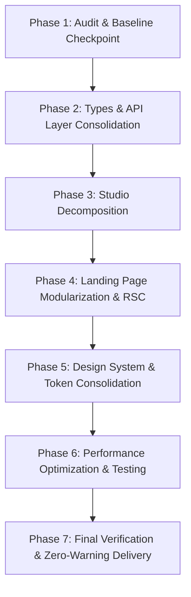

# Frontend Architecture Audit & Phased Refactoring Plan

**Project:** EDINNO AI Assessment Engine Frontend  
**Stack:** Next.js 16.4.2 (App Router with Turbopack), React 19.3.0, TypeScript 5.9, Tailwind CSS v4, Supabase Auth  
**Architect:** Senior Frontend Architect & Performance Engineer  
**Date:** October 2026  
**Status:** Audit Completed • Phased Implementation Plan Ready for Review

---

## 1. Executive Summary & Audit Baseline

A comprehensive technical audit of the `frontend` repository was executed to evaluate code health, architecture, component design, performance, TypeScript strictness, and bundle size.

### Baseline Metrics
| Dimension | Audit Finding | Target State |
| :--- | :--- | :--- |
| **Monolithic Files** | 2 files > 1,400 lines (`studio/page.tsx`: 2,067 lines, `page.tsx`: 1,439 lines) | Modular feature components < 250 lines each |
| **Client Rendering** | 100% of routes use `"use client"` directive | Hybrid Server/Client: Static marketing & curriculum data rendered via RSC; interactive widgets dynamic |
| **ESLint Health** | 105 issues (27 errors, 78 warnings) across 10 files | 0 errors, 0 warnings with strict CI enforcement |
| **TypeScript Coverage** | Multiple `any` types in `api.ts`, `configure/page.tsx`, `utils.ts` | 100% strongly typed with zero `any`, strict type boundary |
| **Design Token Adoption** | < 15% adoption of `design-tokens.ts`; hardcoded hex codes `#B81104`, `#FFFACD` throughout | Centralized Tailwind config / semantic design token classes |
| **Modal Code Splitting** | Modals statically bundled into initial page bundles | Dynamically imported via `next/dynamic` with skeleton suspense |
| **Automated Testing** | 0 frontend unit or integration tests | Vitest + React Testing Library suite for core stores, safety gate, and API clients |

---

## 2. Issues Ranked by Severity and Impact

### Severity 1: Critical Architectural & Maintainability Bottlenecks (P0)
1. **2,067-Line God Component in `src/app/studio/page.tsx`**:
   - *Impact*: Merges sidebar navigation, grade selection, top controls, curriculum explorer, AI question generator, live exam tester, student tracker matrix, safety gate simulator, and PDF upload modal into a single 94 KB client component.
   - *Consequence*: Any state mutation (e.g. typing in search) triggers a complete component subtree re-evaluation. Debugging and adding features requires traversing 2,000+ lines of nested JSX.
2. **1,439-Line Monolith in `src/app/page.tsx`**:
   - *Impact*: Landing page bundles 9 marketing sections, interactive demos, FAQ accordions, and auth listeners into a single client file.
   - *Consequence*: Massive initial client JavaScript hydration cost for content that is 85% static.
3. **Pervasive `"use client"` on All Routes**:
   - *Impact*: Completely disables React Server Components (RSC) benefits in Next.js 16, resulting in larger client bundle size, slower Time-to-Interactive (TTI), and zero server-side pre-fetching.

### Severity 2: Type Safety & API Contract Fragility (P1)
1. **Loose Typing and `any` in Core Data Layer (`src/lib/api.ts`)**:
   - `availableImages?: any[]`, `extractErrorMessage(err: any)`, `rejectedQuestions?: string[]` bypass TypeScript compiler checks.
   - No runtime response schema validation (Zod) on backend responses from `/api/v1/generate-assessment` or `/api/v1/upload-pdfs`.
2. **Duplicated & Disjoint Domain Models**:
   - `types/index.ts` defines `QuestionItem` and `PreAssemblyVerifyResponse`.
   - `lib/curriculum-data.ts` defines `GradeDefinition`, `ChapterItem`, `TopicItem`, `SensorItem`.
   - `app/studio/page.tsx` introduces local duplicates `MockStudent`, `GeneratedQuestion`, `StudioView`.
   - Result: Model fragmentation makes it difficult to maintain cross-view consistency.

### Severity 3: Styling Inconsistency & Token Drift (P2)
1. **Hardcoded Inline Hex Rules**:
   - Thousands of occurrences of `#B81104`, `#8F0D03`, `#FFFACD`, `#F4E88C`, `#FDFBF7` in JSX strings.
   - `lib/design-tokens.ts` exists but is isolated and largely unused.
2. **Ad-Hoc UI Component Duplication**:
   - Badges, pills, buttons, and card wrappers are re-implemented inline across multiple pages rather than consuming `components/ui/StatusPill.tsx`, `CategoryBadge.tsx`, and `QuestionTypeBadge.tsx`.

### Severity 4: Dead Code & Orphaned Modules (P3)
1. **Unused or Divergent Legacy Modules**:
   - `src/components/Header.tsx` (291 lines) is orphaned after the landing page and studio adopted custom floating pill headers.
   - `src/components/app-sidebar.tsx` (269 lines) routes to `/grade/${activeGrade}` which does not exist in the App Router.
   - Multiple unused icon imports from `lucide-react` causing ESLint warnings.

---

## 3. Target Architecture & Module Boundaries

```
frontend/src/
├── app/                              # Next.js App Router (RSC by default)
│   ├── layout.tsx                    # Root layout with font optimization & providers
│   ├── page.tsx                      # Lean RSC composition of landing sections
│   ├── studio/
│   │   ├── page.tsx                  # Lean orchestrator importing feature modules
│   │   └── loading.tsx               # Skeleton loading state
│   ├── ingest/page.tsx               # Dedicated curriculum upload route
│   ├── configure/page.tsx            # Assessment configuration
│   ├── merge/page.tsx                # Master exam merger
│   └── results/page.tsx              # Final review & export
├── features/                         # Domain-driven feature slices
│   ├── studio/                       # Studio dashboard subsystem
│   │   ├── components/
│   │   │   ├── StudioSidebar.tsx     # Floating collapsible pill sidebar
│   │   │   ├── StudioHeader.tsx      # Top grade control & view switcher
│   │   │   ├── CurriculumView.tsx    # Topics, activities, projects & sensors
│   │   │   ├── AssessmentStudio.tsx  # Blueprint configuration & AI question engine
│   │   │   ├── StudentTracker.tsx    # Safety Gate qualification & token roster
│   │   │   └── UploadModal.tsx       # Embedded PDF ingest modal
│   │   ├── hooks/
│   │   │   ├── useStudioState.ts     # Grade, tab, and filter state
│   │   │   └── useAssessmentGen.ts   # Assessment generation lifecycle
│   │   └── types.ts                  # Studio-specific domain types
│   ├── landing/                      # Landing page section modules
│   │   ├── HeroSection.tsx
│   │   ├── HowItWorksSection.tsx
│   │   ├── SensorLabSection.tsx
│   │   ├── AssessmentTypesSection.tsx
│   │   ├── SafetyGateSection.tsx
│   │   └── CurriculumPreviewSection.tsx
│   ├── safety-gate/                  # Pre-Assembly Safety Gate subsystem
│   │   ├── PreAssemblyModal.tsx
│   │   └── useSafetyGate.ts
│   └── auth/                         # Authentication subsystem
│       ├── AuthModal.tsx
│       └── useAuthSession.ts
├── components/                       # Shared design system & UI primitives
│   ├── ui/
│   │   ├── Button.tsx
│   │   ├── Card.tsx
│   │   ├── Badge.tsx
│   │   ├── Modal.tsx
│   │   ├── Input.tsx
│   │   └── Slider.tsx
│   └── layout/
│       ├── Navbar.tsx                # Reusable floating liquid glass pill navbar
│       └── Footer.tsx
├── lib/                              # Core infrastructure & utilities
│   ├── api/                          # Strongly typed API clients with validation
│   │   ├── client.ts                 # Base HTTP client with timeout & error handling
│   │   ├── assessment.ts             # Assessment endpoints
│   │   └── curriculum.ts             # Upload & ingestion endpoints
│   ├── store/                        # State stores
│   │   └── assessment-store.ts
│   ├── supabase/                     # Client & Server Supabase helpers
│   ├── tokens.ts                     # Single source of truth for colors & typography
│   └── utils.ts                      # Shared formatting & class merge helpers
└── types/                            # Unified application schemas & contracts
    ├── domain.ts                     # Core entities (Grade, Chapter, Sensor, Question)
    ├── api.ts                        # Request & response contracts
    └── tracker.ts                    # Student qualification & safety tokens
```

---

## 4. Phased Implementation Roadmap



### Phase 2: Domain Types & API Client Consolidation
- **Objective**: Establish single source of truth for TypeScript types and eliminate `any` from the API layer.
- **Tasks**:
  1. Unify domain types in `types/domain.ts` (merge `curriculum-data.ts`, `types/index.ts`, and local definitions).
  2. Implement strongly typed API error extractor and request handlers in `lib/api/` without `any`.
  3. Add runtime payload validation for API responses using typed schemas.
  4. Fix ESLint errors related to `no-explicit-any` across `api.ts`, `configure/page.tsx`, and `utils.ts`.
- **Verification**: `npm run build` passes; `npx eslint src/lib/api.ts` passes with 0 errors.

### Phase 3: Studio Dashboard Decomposition (`src/app/studio/page.tsx`)
- **Objective**: Break the 2,067-line monolith into focused, decoupled feature components while strictly preserving all functionality and the floating pill sidebar/slightly-rounded aesthetic.
- **Tasks**:
  1. Extract `features/studio/components/StudioSidebar.tsx` (preserves floating pill dock, collapsible state, and G6–G12 selectors).
  2. Extract `features/studio/components/StudioHeader.tsx` (grade summary breadcrumb, tab switcher, safety badge).
  3. Extract `features/studio/components/CurriculumView.tsx` (topics, activities, projects, hardware & sensors shelf).
  4. Extract `features/studio/components/AssessmentStudio.tsx` (blueprint configuration, AI generator, interactive question cards, answer key toggle, copy/print toolbar).
  5. Extract `features/studio/components/StudentTracker.tsx` (metrics cards, student roster table, safety gate pass status, token authorization).
  6. Extract `features/studio/components/UploadModal.tsx` and dynamically import `PreAssemblyQuiz`.
  7. Reduce `src/app/studio/page.tsx` to a clean orchestrator under 150 lines.
- **Verification**: All Grade 6–12 navigation, assessment generation, tracker actions, and modals work seamlessly. `npm run build` succeeds.

### Phase 4: Landing Page Modularization & Server Component Optimization
- **Objective**: Decompose `src/app/page.tsx` (1,439 lines) into modular components and separate static marketing content from interactive state.
- **Tasks**:
  1. Extract `components/layout/Navbar.tsx` (retaining liquid glass floating pill and auth buttons).
  2. Extract `features/landing/components/`: `HeroSection.tsx`, `HowItWorksSection.tsx`, `SensorLabSection.tsx`, `AssessmentTypesSection.tsx`, `SafetyGateSection.tsx`, `CurriculumPreviewSection.tsx`, `FooterSection.tsx`.
  3. Dynamically import `AuthModal.tsx` via `next/dynamic` so auth code is only loaded on user interaction.
  4. Reduce `src/app/page.tsx` to a clean layout composition.
- **Verification**: Visual layout, responsive behavior, floating navbar, and auth modals are 100% regression-free.

### Phase 5: Design Token Consolidation & UI Primitives
- **Objective**: Replace repetitive hardcoded hex classes with centralized design tokens and reusable UI primitives.
- **Tasks**:
  1. Consolidate Milano Red (`#B81104`), Lemon Chiffon (`#FFFACD`), and Warm Ivory (`#FDFBF7`) into Tailwind semantic theme tokens.
  2. Implement reusable UI primitives (`Button`, `Card`, `Badge`, `Modal`) matching the "slightly rounded" (`rounded-lg` / `rounded-md`) standard.
  3. Retire orphaned components (`Header.tsx`, `app-sidebar.tsx`) or re-align them with active routes.
- **Verification**: Consistent aesthetics across all pages; zero broken layouts.

### Phase 6: Performance Optimization & Testing Harness
- **Objective**: Optimize client bundle sizes, eliminate cascading re-renders, and establish test coverage.
- **Tasks**:
  1. Eliminate `react-hooks/set-state-in-effect` warnings and memoize expensive curriculum queries.
  2. Lazy load heavy non-critical UI chunks (modals, print templates) via `next/dynamic`.
  3. Set up Vitest test harness and add automated unit tests for:
     - Curriculum data loader (`getGrade`, `ALL_GRADES`).
     - Pre-assembly safety qualification logic (80% threshold and token issuance).
     - API error extraction and payload construction.
- **Verification**: Automated test suite passes; production build bundle analyzer confirms reduced client footprint.

### Phase 7: Final Codebase Verification & Zero-Warning Delivery
- **Objective**: Achieve a pristine build with zero ESLint errors, zero TypeScript warnings, and verified user flows.
- **Tasks**:
  1. Run `npm run lint` and resolve all remaining unescaped entities, unused imports, and require warnings.
  2. Run `npm run build` to confirm fast prerendering of all 9 routes.
  3. Perform manual verification across desktop and mobile viewports.
- **Verification**: Clean terminal output with exit code 0 on all commands.

---

## 5. Risk Assessment & Mitigations

| Risk | Severity | Mitigation Strategy |
| :--- | :--- | :--- |
| **Breaking Existing Routes/State** | High | Incremental feature-slice refactoring. No route paths or URLs are changed. |
| **Styling Regressions** | Medium | Maintain the exact Tailwind class tokens; preserve floating pill navbar and sidebar while keeping all cards slightly rounded (`rounded-lg`). |
| **Supabase Session Loss** | High | `proxy.ts` and auth state listeners are decoupled and preserved untouched. |
| **Tailwind CSS Compilation Drift** | Medium | Maintain `compile-css.cjs` and verify build output size after each phase. |

---

## 6. Phase Acceptance Criteria

- [ ] **Phase 2 Complete**: Zero `any` in `lib/api/`; unified domain types; TypeScript build clean.
- [ ] **Phase 3 Complete**: `studio/page.tsx` decomposed into `< 150` lines; all 7 grades and 3 views fully functional; modals dynamically loaded.
- [ ] **Phase 4 Complete**: `page.tsx` decomposed into feature sections; navbar cleanly isolated; zero visual regressions.
- [ ] **Phase 5 Complete**: Unified design tokens; orphaned files cleaned up; ESLint errors reduced to 0.
- [ ] **Phase 6 Complete**: Vitest tests passing for core logic; bundle optimized.
- [ ] **Phase 7 Complete**: `npm run lint` and `npm run build` both exit with 0 errors and 0 warnings.

