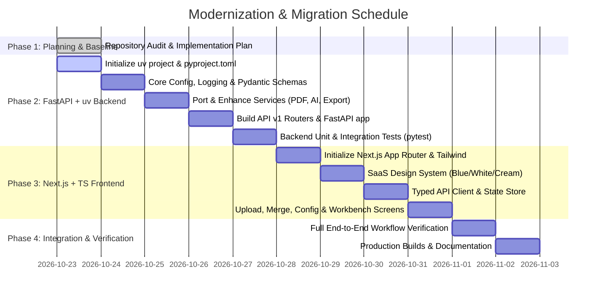

# EDINNO AI Assessment Engine — Modernization & Migration Plan

## 1. Executive Summary & Audit Baseline

### Current State (Legacy)
- **Framework**: Monolithic Flask 3.1.3 (`app.py`, 1016 lines) serving both static Jinja2 HTML templates and synchronous REST endpoints.
- **Dependency Management**: Unpinned, missing `requirements.txt` or lockfile. Required dependencies (`pymupdf`, `reportlab`) were not installed in the host environment.
- **AI Engine**: Hardcoded local Ollama HTTP client in `services/ai_generator.py` targeting `qwen3.5:2b` and `qwen3.5:4b` at `localhost:11434`. Fails with unhandled connection errors if Ollama is not active or models are missing.
- **Frontend**: 4 Jinja2 HTML templates (`index.html`, `merge.html`, `assessment_type.html`, `results.html`) containing over 130 KB of unminified inline JavaScript and CSS styling. State management relies entirely on browser `sessionStorage`, creating a hard 5MB storage limit risk when uploading multi-page curriculum PDFs.
- **Target Architecture**:
  - **Backend**: FastAPI with async execution, strict Pydantic V2 schemas, structured logging, centralized error handling, and `uv` package management.
  - **Frontend**: Next.js 15+ App Router, TypeScript, Tailwind CSS, Lucide icons, adhering to the **Blue / White / Cream (Off-white)** SaaS color system.
  - **AI Resilience**: Multi-provider support (Ollama + Google Gemini 2.5/3.8 Flash fallback + deterministic mock mode for testing/CI).
  - **Document Processing**: Robust PyMuPDF stream processing and ReportLab A4 styling with PostScript core fonts.

---

## 2. Phased Implementation Roadmap

---

## 3. Detailed Phase Breakdown

### Phase 1: Planning, Schema Design & Environment Setup
- **Tasks**:
  1. Audit existing API contracts (`/upload-pdfs`, `/detect-project-name`, `/generate-assessment`, `/generate-pre-assembly`, `/download-assessment`).
  2. Define Pydantic V2 schemas for questions, options, upload responses, and error payloads.
  3. Create backend structure using `uv init`.

### Phase 2: Backend Migration (FastAPI + uv)
- **Directory**: `backend/`
- **Dependencies**: `fastapi`, `uvicorn[standard]`, `pydantic-settings`, `pymupdf`, `reportlab`, `requests`, `google-genai`, `pytest`, `httpx`.
- **Key Modules**:
  - `backend/app/core/config.py`: Environment settings (CORS, Ollama URL, Gemini API Key, Max Upload Size).
  - `backend/app/core/logging.py`: Structured JSON/Console logging.
  - `backend/app/schemas/`: `UploadResponse`, `QuestionItem`, `AssessmentRequest`, `AssessmentResponse`.
  - `backend/app/services/pdf_reader.py`: Async-wrapped PyMuPDF text extractor.
  - `backend/app/services/ai_generator.py`: Hybrid AI generation engine supporting:
    - Ollama (`qwen3.5:2b` / `qwen3.5:4b`)
    - Gemini API (`gemini-2.5-flash` / `gemini-3.8-flash`)
    - Offline fallback simulator for CI/automated tests
    - Tokenization, stopwords, SequenceMatcher deduplication, and schema validation.
  - `backend/app/services/pdf_generator.py`: ReportLab Platypus A4 document generator with Student Details box, instructions, questions, and Answer Key appendix.
  - `backend/app/api/v1/`: Versioned endpoints preserving exact legacy parameter compatibility while providing modern REST JSON contracts.
  - `backend/tests/`: Automated test suite testing extraction, prompt generation, deduplication, and PDF creation.

### Phase 3: Frontend Migration (Next.js App Router + TypeScript)
- **Directory**: `frontend/`
- **Tech Stack**: Next.js 15, React 19/18, TypeScript, Tailwind CSS, Lucide React icons.
- **Design System Tokens**:
  - **Primary Blue**: `#2563EB` (Blue-600) / Active `#1D4ED8` (Blue-700)
  - **Background Cream/Off-white**: `#FBF9F5` (Warm Alabaster) / Secondary `#F3EFEA`
  - **Clean Surface White**: `#FFFFFF` with subtle `#E7E2D9` warm borders
  - **Text Neutral**: `#1E293B` (Slate-850) and `#64748B` (Muted Slate)
- **Application Views**:
  - `/` (Upload Wizard): Dynamic counter for Topics, Activities, Projects; drag-and-drop file cards; upload progress and batch extraction.
  - `/merge` (Curriculum Review): Aggregated content preview, page counts, word counts, quick inspection.
  - `/configure` (Assessment Settings): Assessment scope selection (Pre-Assembly 5Q, Single Module, Chapter End Mixed, Master Assessment), difficulty toggles, question count sliders.
  - `/results` (Interactive Assessment Workbench):
    - Question cards with inline editing of question text, options, and answer explanations.
    - Add question, delete question, and reorder.
    - Toggle teacher answer key / student view.
    - One-click "Export PDF" button triggering backend ReportLab generation.

### Phase 4: Integration, Verification & Quality Assurance
- **Verification Matrix**:
  1. Test PDF upload and text extraction with real `Chapter 7 (Arduino)` files.
  2. Verify project name auto-detection.
  3. Verify question generation (Ollama / Gemini / Fallback).
  4. Verify ReportLab PDF download matches professional formatting standards.
  5. Run `pytest` on backend.
  6. Run `npm run build` on frontend to verify zero TypeScript or JSX compile errors.

---

## 4. Rollback & Risk Mitigation Strategy
- **Preservation**: The original `app.py`, `services/`, `templates/`, and `static/` remain intact and uncorrupted.
- **Zero Loss**: All sample PDFs in `Chapter 7 (Arduino)/` remain untouched.
- **Port Conflict Prevention**: FastAPI default port `8000`, Next.js default port `3000`, legacy Flask port `5000`.
- **AI Availability**: If neither local Ollama nor Gemini API key is available, the service gracefully degrades to a deterministic curriculum assessment synthesizer rather than crashing with an unhandled exception.
